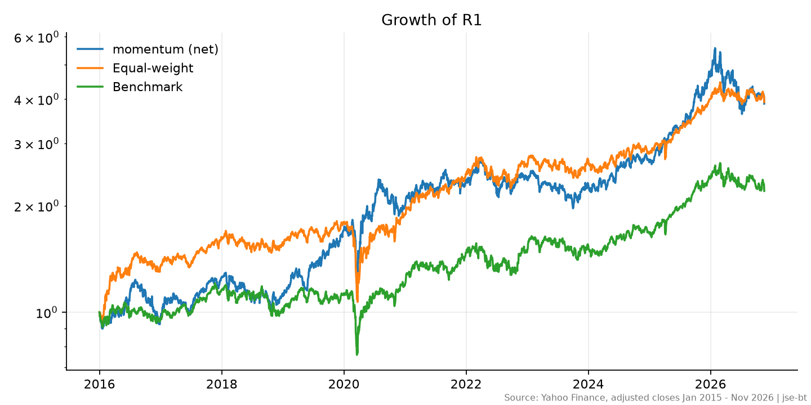
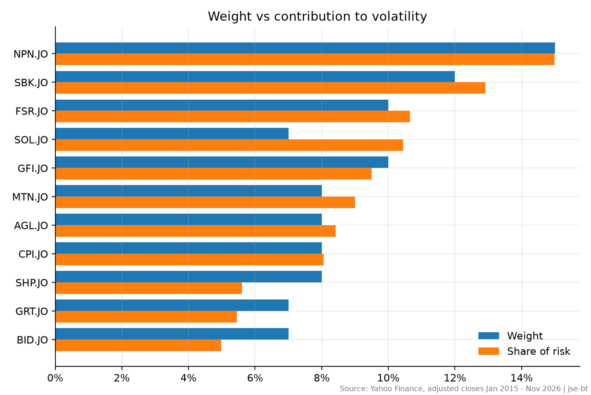
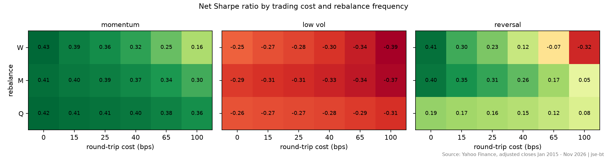
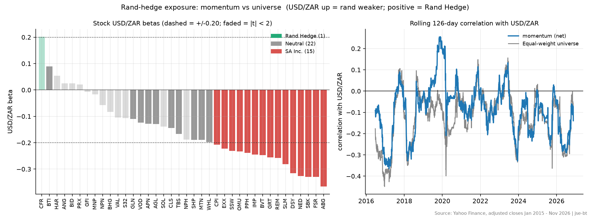

# JSE Portfolio Risk & Factor Backtester

Risk analytics and factor backtesting for Johannesburg Stock Exchange (JSE) equities, engineered around South African market microstructure: a concentrated Top 40 universe, fat-tailed returns, a Rand-denominated risk-free rate, JSE Securities Transfer Tax (0.25% STT) + brokerage friction, and USD/ZAR Rand-hedge currency decomposition.

```bash
jse-bt backtest --factor momentum --top-frac 0.3 --rebalance M --source yfinance
jse-bt risk --weights examples/sample_portfolio.csv --source yfinance
jse-bt cost-grid --source yfinance     # factor x rebalance x trading-cost sensitivity
jse-bt charts --source yfinance        # regenerate every chart in docs/ from real JSE data
streamlit run app/streamlit_app.py
```

> **Real JSE Market Data (`2016–2026`, `--source yfinance`):** All charts below were generated from historical JSE daily adjusted closes after automated ZAc/ZAR unit-flip sanitisation. An offline `--source synthetic` mode is also built in so all 83 `pytest` unit tests run deterministically in CI without internet access.

## Key Empirical Findings (JSE 2016–2026)

* **Transaction Costs Decide Factor Viability:** Short-term weekly reversal (`reversal / W`) delivers **15.22% CAGR** before costs, but its **1,848% annual turnover** collapses to **2.15% net CAGR (`-0.07` Sharpe)** under realistic JSE friction (`~65 bps` round-trip including `0.25%` STT). By contrast, quarterly momentum (`momentum / Q`, **156% annual turnover**) preserves **14.13% net CAGR (`0.38` Sharpe)** vs. **7.53% CAGR** for the Satrix 40 benchmark (`STX40.JO`).
* **Momentum Is Not a Disguised Rand Bet:** Look-through USD/ZAR beta decomposition shows that monthly JSE momentum carries a **-0.14 USD/ZAR beta** vs. **-0.16** for the equal-weight universe (`+0.02` tilt), confirming that returns stem from cross-sectional price momentum rather than macro ZAR weakness.
* **Automated JSE Data Hygiene:** Across 38 JSE tickers and `USDZAR=X` (`2016–2026`), the sanitiser automatically detected and rescaled **10 Yahoo Finance ZAc/ZAR 100x currency-unit flips** (`SBK.JO`, `STX40.JO`, `VOD.JO`, `PPH.JO`, `SLM.JO`) and removed **2 reverting bad FX prints** while preserving genuine tail events (`SOL.JO` `-46.6%` during the March 2020 shock).






*Rand-hedge chart: stock-level USD/ZAR betas coloured by bucket (left) and rolling 126-day correlation of the strategy and equal-weight universe with USD/ZAR (right).*

## Features

**Risk (`risk.py`)**
- CAGR, volatility, Sharpe, Sortino, Calmar, max drawdown (against a configurable SA risk-free rate)
- 1-day VaR / CVaR: historical, parametric and **Cornish-Fisher** (skew/kurtosis adjusted)
- Beta, Jensen alpha, tracking error, information ratio vs benchmark (`STX40.JO`)
- Euler **risk contributions** from a shrunk (constant-correlation) covariance matrix, diversification ratio, sector exposure
- Historical stress windows (Nenegate 2015, Steinhoff 2017, COVID 2020; configurable via `SCENARIOS`)

**Currency & Rand-Hedge Decomposition (`risk.py`, `backtest.py`)**
- **USD/ZAR beta** per stock: OLS of daily ZAR returns on daily `USDZAR=X` percentage changes with **Newey-West** t-stats (5 lags). Buckets: **Rand Hedge** (β > +0.20), **Neutral** (-0.20 ≤ β ≤ +0.20), and **SA Inc.** (β < -0.20).
- **Portfolio Currency Exposure Breakdown:** Reports realised portfolio USD/ZAR beta, daily drifted look-through beta, rolling 126-day correlation with `USDZAR=X`, and weight split across Rand Hedge / Neutral / SA Inc. buckets vs. the equal-weight universe.
- Exports `usdzar_betas.csv` alongside every report and generates `rand_hedge.png` (`risk_rand_hedge.png` for `risk`).

**Factors (`factors.py`)**
- Price-based signals: 12-1 momentum, low volatility, short-term reversal
- Rank **information coefficient** (Spearman, 21-day forward) with IC IR, t-stat, and hit rate
- Factor regressions with **Newey-West** HAC t-statistics

**Data Hygiene (`sanitize.py`)**
- Detects ~100x / 0.01x day-on-day ZAc/ZAR unit flips in Yahoo Finance `.JO` feeds, segments the series, and rescales each segment to the dominant unit while preserving genuine glitch-day returns.
- Removes one-day bad prints that revert the next day (`USDZAR=X` and equities), while flagging persistent real crashes or corporate actions without altering them.
- Logs every event in a *Data quality* report section and `data_quality.csv`.

**Backtester (`backtest.py`) & Cost Sensitivity (`costgrid.py`)**
- Rank-based long-only or long/short portfolios, equal or inverse-vol weighted, weekly/monthly/quarterly rebalancing with a 1-day signal-to-execution lag to prevent look-ahead bias.
- Models **0.25% JSE STT on purchases** plus configurable brokerage each way, reporting turnover and annual cost drag.
- Exact `cost-grid` simulator testing Momentum, Low Volatility, and Reversal across `W / M / Q` rebalancing and round-trip costs from `0` to `100 bps`.

## Install & Run

```bash
git clone https://github.com && cd jse-risk-backtester
pip install -e ".[dev,app]"
pytest -q
jse-bt backtest --source yfinance --out reports/real
streamlit run app/streamlit_app.py
```

## Method Notes

| Topic | Choice |
|---|---|
| Returns | Simple daily returns from adjusted closes |
| Weights drift | Between rebalances weights drift with returns; costs apply only on trades |
| Turnover | Sum of absolute weight changes / 2 |
| Costs | `cost = buys x (STT + brokerage) + sells x brokerage` |
| Covariance | Sample covariance shrunk 10% toward constant correlation |
| Factor returns | Cost-free long/short (top vs bottom 30%), plus equal-weight market excess return (`MKT`) |
| Regressions | OLS on daily excess returns, Newey-West HAC errors (5 lags) |
| USD/ZAR beta | OLS of daily stock return on daily `USDZAR=X` % change, Newey-West (5 lags); minimum 250 common days |
| Rand-hedge buckets | Rand Hedge > +0.20, Neutral in [-0.20, +0.20], SA Inc. < -0.20 |

## Limitations

- **Survivorship bias:** The universe reflects current JSE large caps; delisted or demoted constituents are excluded.
- **Price-based factors only:** Free feeds provide current rather than point-in-time historical fundamentals, which are excluded to avoid look-ahead bias.
- **Execution assumptions:** Market impact, dividend withholding tax, and short-selling borrow costs are not modelled.
- **Univariate currency betas:** Because the Rand is a risk-on/risk-off currency, univariate USD/ZAR betas partly reflect global equity market beta.
- Educational/research software, not investment advice.

## Roadmap

- [x] USD/ZAR currency & rand-hedge beta decomposition (`risk`, `backtest`, `docs/rand_hedge.png`, Streamlit panel)
- [x] Transaction-cost sensitivity grid (`jse-bt cost-grid` & heatmaps)
- [x] Automated JSE ZAc/ZAR 100x unit-flip sanitiser
- [ ] Point-in-time fundamentals (value, quality, profitability) via CSV loader
- [ ] Historical JSE index constituents to remove survivorship bias
- [ ] Portfolio optimisation (min-variance, risk parity) using the shrunk covariance estimator

## Layout

```text
src/jse_backtester/  data, sanitize, universe, risk, factors, backtest, costgrid, plots, cli
app/streamlit_app.py interactive Streamlit dashboard
tests/               83 pytest unit tests (runs offline on synthetic data)
examples/            sample portfolio weights
docs/                README charts generated from --source yfinance
```

MIT licensed.
